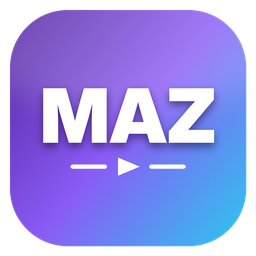

<div align="center">



# MAZ Launcher

**Alle deine Spiele. Ein Launcher.**
Steam, Epic Games und deine eigenen Spiele – in einer schönen, schnellen und kleinen App.


[](https://github.com/MikeAdamRGB/MAZ-Lauchner/actions/workflows/build.yml)

</div>

---

## ✨ Was kann der MAZ Launcher?

| | |
|---|---|
| 🎮 **Steam** | Findet automatisch alle installierten Steam-Spiele – auf allen Festplatten. Optional mit Steam-API-Schlüssel: **alle** gekauften Spiele inkl. Spielzeit. |
| 🟦 **Epic Games** | Findet automatisch alle installierten Epic-Spiele. |
| 🚀 **Eigene Spiele** | Füge jedes Spiel hinzu (EXE, Verknüpfung, Batch-Datei). Vor **jedem** Start kommt die Frage: *„Hast du alles Wichtige deaktiviert?“* – bei **Nein** startet das Spiel nicht. |
| 🖼️ **Original-Icons & Cover** | Echte Spiel-Icons (direkt aus der EXE bzw. aus Steam) und Original-Cover. Eigene Cover kannst du für jedes Spiel setzen. |
| 🎨 **3 Ansichten** | Sieht aus **wie die Steam-Bibliothek**, **wie Epic Games** – oder im **eigenen MAZ-Stil**. |
| 🌈 **8 Farbschemata** | MAZ Violett, Mitternacht, Neon, Glut, Wald, Sakura, OLED Schwarz, Hell – plus eigene Akzentfarbe. |
| 🛟 **Fehler einfach erklärt** | Startet etwas nicht, erklärt der Launcher **Schritt für Schritt** in einfachen Worten, was los ist und wie man es behebt – mit Knöpfen, die direkt helfen (z. B. „Als Administrator starten“, „Visual C++ herunterladen“). |
| 📦 **Eingebauter Installer** | Eine einzige EXE: Doppelklick → Installationsmenü mit Desktop-Verknüpfung, Startmenü, „Jetzt öffnen“ und „App-Ordner öffnen“. Kein Admin nötig. |
| 🪶 **Winzig** | Eine einzige, auf Größe optimierte EXE – keine Zusatzdateien. |

---

## 📥 Installation (für alle)

1. Lade die neueste **`MAZ-Launcher.exe`** unter [**Releases**](https://github.com/MikeAdamRGB/MAZ-Lauchner/releases) herunter.
2. **Doppelklick** auf die Datei.
3. Im Installationsmenü auf **„Installieren“** klicken.
4. Fertig! Klick auf **„Jetzt öffnen“** – ab jetzt startest du den Launcher über die Desktop-Verknüpfung.

> **Windows zeigt „Der Computer wurde durch Windows geschützt“?**
> Das kommt bei neuen Programmen ohne teures Zertifikat. Klick auf **„Weitere Informationen“** → **„Trotzdem ausführen“**.

> **Lieber ohne Installation?** Im Installationsmenü auf **„Ohne Installation starten“** klicken – oder neben die EXE eine leere Datei namens `portable.txt` legen.

**Deinstallieren:** Windows-Einstellungen → Apps → „MAZ Launcher“ → Deinstallieren (oder im Launcher unter Einstellungen → Allgemein). Deine Spiele bleiben dabei natürlich erhalten.

---

## 🕹️ So benutzt du ihn

- **Spielen:** Mit der Maus über ein Spiel fahren und auf ▶ klicken. Ein Klick auf das Cover öffnet die Details.
- **Eigenes Spiel hinzufügen:** Links auf **„Spiel hinzufügen“** → bei „Programm“ auf **„Durchsuchen…“** → die Start-Datei des Spiels wählen → **„Hinzufügen“**.
- **Aussehen ändern:** Einstellungen → **Design** → Ansicht (MAZ / Steam / Epic) und Farbschema wählen.
- **Alle Steam-Spiele sehen (auch nicht installierte):** Einstellungen → **Verbindungen** → kostenlosen Steam-API-Schlüssel eintragen (die Anleitung steht direkt daneben).
- **Sicherheitsfrage anpassen:** Einstellungen → **Eigene Spiele** → Punkte hinzufügen, ändern oder löschen. Pro Spiel kannst du zusätzliche Punkte festlegen.

### Diese Fehler erklärt der Launcher automatisch

Spieldatei fehlt · Laufwerk/USB-Platte nicht eingesteckt · Admin-Rechte nötig · Zugriff verweigert · falsche Datei gewählt · vom Virenschutz blockiert · von Windows/Smart App Control blockiert · Datei wird benutzt · fehlende DLLs (Visual C++ / DirectX) · Fehler **0xc000007b** · **0xc0000142** · Absturz direkt nach dem Start · Steam bzw. Epic nicht installiert · Steam/Epic reagiert nicht · falscher Steam-API-Schlüssel · WebView2 fehlt · Installation fehlgeschlagen.

---

## 🛠️ Selbst bauen (für Entwickler)

**Voraussetzungen:** [Rust](https://rustup.rs) (stable) unter Windows. Sonst nichts – kein Node.js, kein Dioxus-CLI.

```powershell
git clone https://github.com/MikeAdamRGB/MAZ-Lauchner.git
cd MAZ-Lauchner
cargo run                 # Entwickeln
cargo build --release     # Fertige EXE: target\release\MAZ-Launcher.exe
.\scripts\build.ps1 -Mini # EXE nach dist\ + zusätzlich mit UPX gepackte Mini-Version
```

Das fertige CSS (`assets/maz.css`) liegt schon im Repo und wird in die EXE eingebettet. Nur wenn du Tailwind-Klassen änderst:

```powershell
.\scripts\build-css.ps1   # lädt einmalig die eigenständige Tailwind-EXE (kein Node.js)
```

**Release erstellen:** Tag pushen (`git tag v1.0.0 && git push --tags`) – GitHub Actions baut die EXE und hängt sie automatisch an das Release.

### Technik

| Teil | Womit |
|---|---|
| Oberfläche | [Dioxus 0.7](https://dioxuslabs.com) (Desktop, WebView2) |
| Komponenten | im Stil von [rust-ui](https://github.com/rust-ui/ui) (Button, Card, Badge, Input, Switch, Dialog … – gleiche Varianten/Klassen) |
| Styling | Tailwind CSS v4, Themes über CSS-Variablen |
| Steam | Registry → `libraryfolders.vdf` → `appmanifest_*.acf` (eigener VDF-Parser), Bilder aus dem Steam-Cache, optional Steam-Web-API |
| Epic | Registry → Launcher-Manifeste (`*.item`) |
| Icons | Original-Icons per Windows-API direkt aus der EXE (256 px) |
| HTTP | `ureq` mit Windows-eigenem TLS (SChannel) → keine große TLS-Bibliothek |

### Warum ist die EXE so klein?

- `opt-level = "z"`, `lto = "fat"`, `codegen-units = 1`, `panic = "abort"`, `strip = true`
- Dioxus nur mit minimalen Features, keine Router-/Fullstack-Teile
- Windows-Funktionen über direkte API-Aufrufe statt großer Binding-Crates
- TLS über das in Windows eingebaute SChannel
- Bilder nur PNG/JPEG, CSS minifiziert und eingebettet
- Optional: `MAZ-Launcher-mini.exe` mit UPX gepackt (manche Virenscanner melden gepackte EXEs fälschlich – dann die normale Version nehmen)

### Projektstruktur

```
src/
├── main.rs        Start, Fenster, Absturz-Meldungen
├── install.rs     eingebauter Installer & Deinstallation
├── steam.rs       Steam-Erkennung (+ Web-API, Cover-Suche)
├── epic.rs        Epic-Games-Erkennung
├── library.rs     führt alles zur Bibliothek zusammen
├── launch.rs      Spiele starten + Absturz-Erkennung
├── problem.rs     alle Fehlererklärungen (einfache Sprache)
├── icons.rs       Original-Icons aus EXEs
├── vdf.rs         Parser für Valves VDF-Format
├── winffi.rs      direkte Windows-API-Aufrufe
├── config.rs / model.rs / sys.rs
└── ui/            Oberfläche (Bibliothek in 3 Stilen, Dialoge, Einstellungen, Installer)
```

Einstellungen liegen in `%APPDATA%\MAZ Launcher\config.json`, der Bilder-Cache in `%LOCALAPPDATA%\MAZ Launcher`.

---

## ❓ FAQ

**Lädt der Launcher Spiele herunter oder umgeht er Kopierschutz?**
Nein. Steam- und Epic-Spiele werden immer über den Original-Launcher gestartet. Es werden keine Passwörter abgefragt.

**Warum sehe ich nicht alle meine Epic-Spiele?**
Epic gibt die Liste der gekauften Spiele nur nach einer Anmeldung heraus. Der MAZ Launcher zeigt alle **installierten** Epic-Spiele.

**Das Fenster bleibt weiß / startet nicht.**
Der Launcher braucht Microsoft WebView2 (bei Windows 10/11 normalerweise dabei). Fehlt es, erklärt der Launcher beim Start, wie man es installiert.

---

## 📄 Lizenz

[MIT](LICENSE) © MikeAdamRGB

Komponenten-Design angelehnt an [rust-ui](https://github.com/rust-ui/ui) (MIT).
Steam ist eine Marke der Valve Corporation, Epic Games ist eine Marke von Epic Games, Inc. Dieses Projekt ist unabhängig und mit keinem der beiden verbunden.
