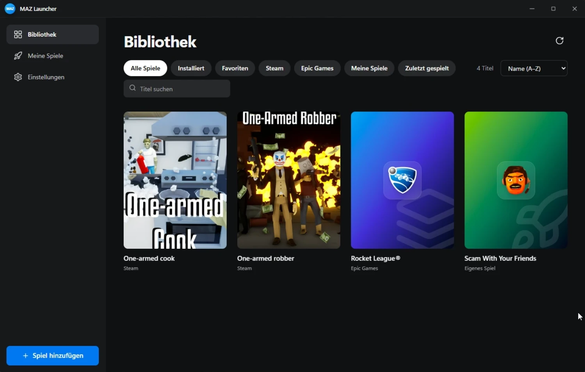
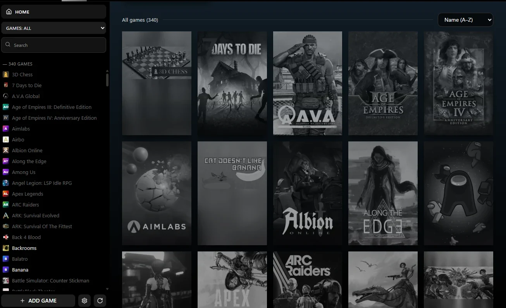
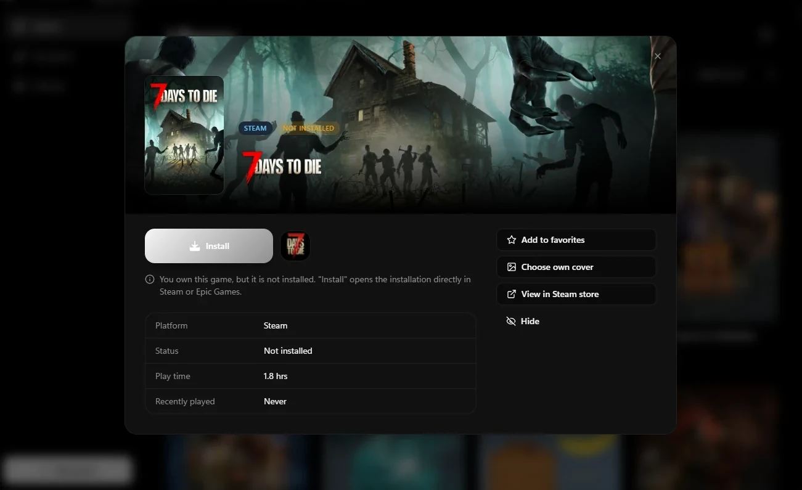
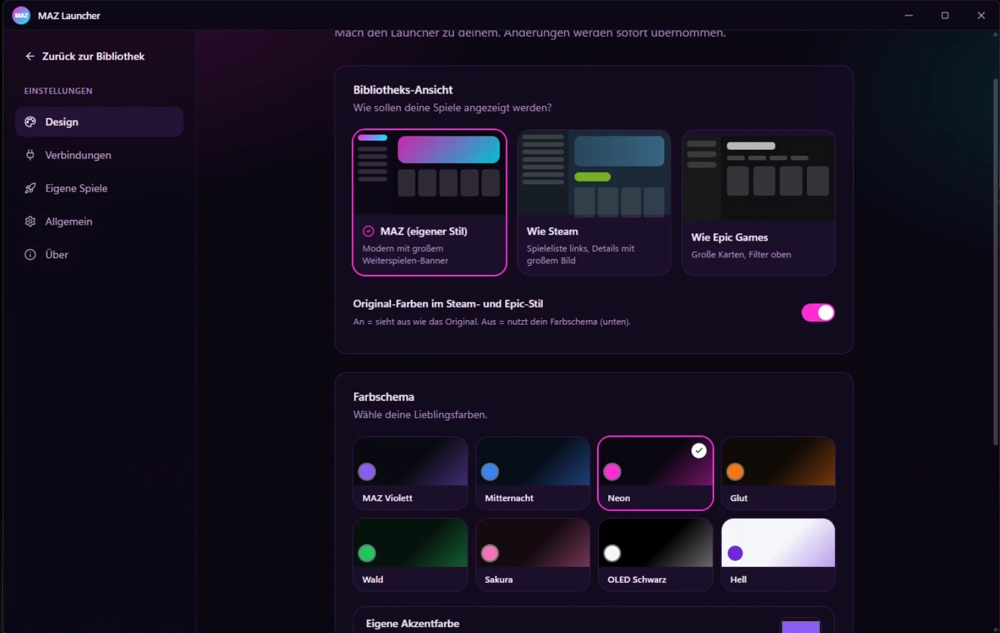

<div align="center">


# MAZ Launcher

**All your games. One launcher.**

Steam, Epic Games and your own games in one fast, lightweight and good-looking Windows app, written in 100% Rust.

[](https://github.com/MikeAdamRGB/MAZ-Lauchner/releases/latest)
[](https://github.com/MikeAdamRGB/MAZ-Lauchner/releases)
[](https://github.com/MikeAdamRGB/MAZ-Lauchner/actions/workflows/build.yml)


[](LICENSE)

**English** · [Deutsch](docs/i18n/README.de.md) · [Français](docs/i18n/README.fr.md) · [Español](docs/i18n/README.es.md) · [Italiano](docs/i18n/README.it.md) · [Português](docs/i18n/README.pt-BR.md) · [Polski](docs/i18n/README.pl.md) · [Türkçe](docs/i18n/README.tr.md) · [Русский](docs/i18n/README.ru.md) · [日本語](docs/i18n/README.ja.md) · [한국어](docs/i18n/README.ko.md) · [简体中文](docs/i18n/README.zh-CN.md)

[**⬇️ Download for Windows**](https://github.com/MikeAdamRGB/MAZ-Lauchner/releases/latest)

<br>



</div>

---

## Table of contents

- [Features](#features)
- [Screenshots](#screenshots)
- [Installation](#installation)
- [Usage](#usage)
- [Building from source](#building-from-source)
- [Tech stack](#tech-stack)
- [FAQ](#faq)
- [Contributing](#contributing)
- [License](#license)

> [!NOTE]
> The app interface is currently available in **German**. The labels quoted below (for example **„Spiel hinzufügen“**) are shown exactly as they appear in the app, with an English translation alongside.

## Features

| | |
|---|---|
| 🎮 **Steam** | Detects every installed Steam game automatically, across all drives. With an optional Steam Web API key it can also show **all** owned games, including playtime. |
| 🟦 **Epic Games** | Detects every installed Epic Games title automatically. |
| 🚀 **Your own games** | Add any game: an `.exe`, a shortcut or a batch file. Before **every** launch a safety checklist asks *"Have you turned off everything important?"*. If you answer **No**, the game does not start. |
| 🖼️ **Original icons & covers** | Real game icons (taken straight from the EXE or from Steam) and original cover art. You can set a custom cover for any game. |
| 🎨 **3 library layouts** | Looks like **the Steam library**, like **Epic Games**, or uses the launcher's own **MAZ style**. |
| 🌈 **8 color themes** | MAZ Violet, Midnight, Neon, Ember, Forest, Sakura, OLED Black and Light, plus a custom accent color. |
| 🛟 **Errors explained in plain words** | If something won't start, the launcher explains **step by step** what happened and how to fix it, with buttons that fix it directly (for example *Run as administrator* or *Download Visual C++*). |
| 📦 **Built-in installer** | One single EXE: double-click it to get an install menu with a desktop shortcut, a Start menu entry, *Open now* and *Open app folder*. No admin rights required. |
| 🪶 **Tiny footprint** | One size-optimized EXE with no extra files. |

## Screenshots

<table>
  <tr>
    <td width="50%" align="center">
      <br>
      <sub><b>Steam style</b>: game list on the left, "Recently played" and all games in a grid</sub>
    </td>
    <td width="50%" align="center">
      <br>
      <sub><b>Epic Games style</b>: large cards with filters along the top</sub>
    </td>
  </tr>
  <tr>
    <td width="50%" align="center">
      <br>
      <sub><b>Game details</b>: play, favorite, open the game folder, set a custom cover</sub>
    </td>
    <td width="50%" align="center">
      <br>
      <sub><b>Design settings</b>: 3 layouts, 8 color themes and a custom accent color</sub>
    </td>
  </tr>
</table>

## Installation

**Requirements:** Windows 10 or 11 (64-bit) with [Microsoft WebView2](https://developer.microsoft.com/microsoft-edge/webview2/), which comes preinstalled on current Windows versions.

1. Download the latest **`MAZ-Launcher.exe`** from [**Releases**](https://github.com/MikeAdamRGB/MAZ-Lauchner/releases/latest).
2. **Double-click** the file.
3. Click **„Installieren“** (*Install*) in the install menu.
4. Done. Click **„Jetzt öffnen“** (*Open now*). From then on, start the launcher from the desktop shortcut.

> [!TIP]
> **Windows shows "Windows protected your PC"?**
> This happens with new programs that aren't signed with a paid code-signing certificate. Click **More info**, then **Run anyway**.

> [!TIP]
> **Prefer a portable version?** Click **„Ohne Installation starten“** (*Start without installing*) in the install menu, or place an empty file named `portable.txt` next to the EXE.

**`MAZ-Launcher-mini.exe`** is the same app compressed with UPX. Some antivirus programs wrongly flag packed EXEs; if that happens, use the regular version.

**Uninstall:** Windows Settings → Apps → "MAZ Launcher" → Uninstall, or in the launcher under **Einstellungen → Allgemein** (*Settings → General*). Your games are not touched.

## Usage

- **Play:** hover over a game and click ▶. Clicking the cover opens the game details.
- **Add your own game:** click **„Spiel hinzufügen“** (*Add game*) on the left → **„Durchsuchen…“** (*Browse…*) next to "Programm" → pick the game's executable → **„Hinzufügen“** (*Add*).
- **Change the look:** **Einstellungen → Design** (*Settings → Design*) → choose a layout (MAZ / Steam / Epic) and a color theme.
- **See all Steam games, including uninstalled ones:** **Einstellungen → Verbindungen** (*Settings → Connections*) → enter a free Steam Web API key. Instructions are shown right next to the field.
- **Customize the safety checklist:** **Einstellungen → Eigene Spiele** (*Settings → Own games*) → add, edit or delete items. You can also add extra items per game.

### Errors the launcher explains for you

Missing game file · drive or USB disk not connected · administrator rights required · access denied · wrong file selected · blocked by antivirus · blocked by Windows / Smart App Control · file in use · missing DLLs (Visual C++ / DirectX) · error **0xc000007b** · **0xc0000142** · crash right after launch · Steam or Epic not installed · Steam or Epic not responding · invalid Steam API key · WebView2 missing · installation failed.

## Building from source

**Requirements:** [Rust](https://rustup.rs) (stable, 1.85 or newer) on Windows. Nothing else: no Node.js and no Dioxus CLI.

```powershell
git clone https://github.com/MikeAdamRGB/MAZ-Lauchner.git
cd MAZ-Lauchner
cargo run                 # development build
cargo build --release     # release EXE: target\release\MAZ-Launcher.exe
.\scripts\build.ps1 -Mini # copies the EXE to dist\ and also builds a UPX-packed mini version
```

The compiled stylesheet (`assets/maz.css`) is checked into the repository and embedded into the EXE. You only need to rebuild it after changing Tailwind classes:

```powershell
.\scripts\build-css.ps1   # downloads the standalone Tailwind CLI once (no Node.js needed)
```

**Publishing a release:** push a tag (`git tag v1.0.0 && git push --tags`). GitHub Actions builds the EXE and attaches it to the release automatically.

## Tech stack

| Part | Technology |
|---|---|
| UI | [Dioxus 0.7](https://dioxuslabs.com) (desktop, WebView2) |
| Components | Modeled on [rust-ui](https://github.com/rust-ui/ui) (Button, Card, Badge, Input, Switch, Dialog… with the same variants and classes) |
| Styling | Tailwind CSS v4, themes via CSS custom properties |
| Steam | Registry → `libraryfolders.vdf` → `appmanifest_*.acf` (custom VDF parser), artwork from the Steam cache, optional Steam Web API |
| Epic Games | Registry → launcher manifests (`*.item`) |
| Icons | Original icons extracted from the EXE through the Windows API (256 px) |
| HTTP | `ureq` with native Windows TLS (SChannel), so no large TLS library is bundled |

<details>
<summary><b>Why is the EXE so small?</b></summary>

- `opt-level = "z"`, `lto = "fat"`, `codegen-units = 1`, `panic = "abort"`, `strip = true`
- Dioxus with only the minimal feature set, no router or fullstack parts
- Windows functionality through direct API calls instead of large binding crates
- TLS through the SChannel stack built into Windows
- Only PNG/JPEG image decoding; CSS minified and embedded
- Optional UPX-packed `MAZ-Launcher-mini.exe`

</details>

<details>
<summary><b>Project structure</b></summary>

```
src/
├── main.rs        entry point, window, crash reporting
├── install.rs     built-in installer and uninstaller
├── steam.rs       Steam detection (+ Web API, cover lookup)
├── epic.rs        Epic Games detection
├── library.rs     merges everything into one library
├── launch.rs      game launching + crash detection
├── problem.rs     all error explanations (plain language)
├── icons.rs       original icons from EXEs
├── vdf.rs         parser for Valve's VDF format
├── winffi.rs      direct Windows API calls
├── config.rs / model.rs / sys.rs
└── ui/            interface (library in 3 styles, dialogs, settings, installer)
```

Settings are stored in `%APPDATA%\MAZ Launcher\config.json`, the image cache in `%LOCALAPPDATA%\MAZ Launcher`.

</details>

## FAQ

**Does the launcher download games or bypass copy protection?**
No. Steam and Epic games are always started through their official launchers. The launcher never asks for passwords.

**Why don't I see all of my Epic games?**
Epic only provides the list of owned games after signing in. MAZ Launcher shows all **installed** Epic games.

**The window stays white or doesn't open.**
The launcher needs Microsoft WebView2, which is normally included with Windows 10 and 11. If it is missing, the launcher explains on startup how to install it.

**Is my data sent anywhere?**
No accounts and no telemetry. Network access is only used for cover art and, if you add a key, the Steam Web API.

## Contributing

Bug reports, ideas and pull requests are welcome.

- 🐞 [Report a bug](https://github.com/MikeAdamRGB/MAZ-Lauchner/issues/new/choose)
- 💡 [Suggest an idea](https://github.com/MikeAdamRGB/MAZ-Lauchner/issues/new/choose)
- 🛠️ Read [CONTRIBUTING.md](CONTRIBUTING.md) before opening a pull request

## License

Released under the [MIT License](LICENSE) © MikeAdamRGB.

Component design inspired by [rust-ui](https://github.com/rust-ui/ui) (MIT).
Steam is a trademark of Valve Corporation. Epic Games is a trademark of Epic Games, Inc. This project is independent and not affiliated with either company.

<div align="center">
<br>
<sub>Made with 💜 and 🦀 Rust</sub>
</div>
